<div align="center">
  <a href="https://sparkchat.plovatto.dev/en/">
    <picture>
      <source media="(prefers-reduced-motion: reduce)" srcset="./.github/assets/hero-still-en.webp">
      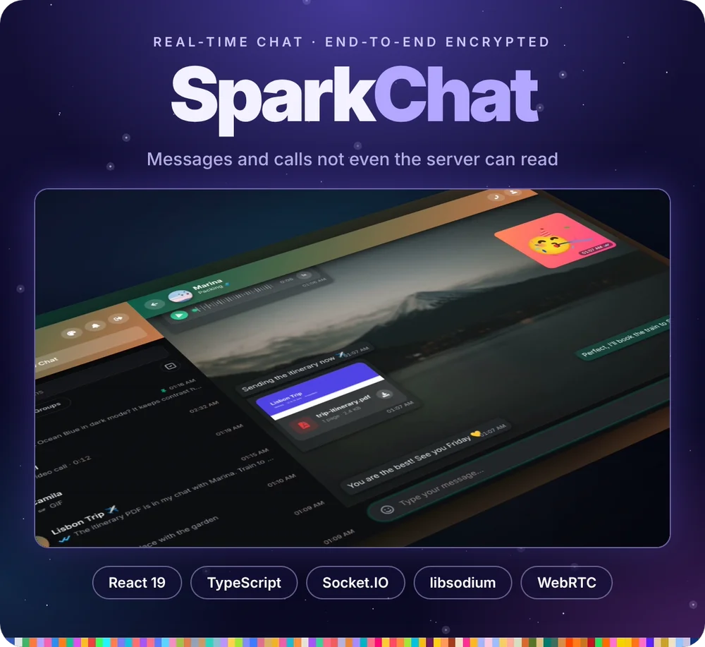
    </picture>
  </a>

  <br>
  <br>

<a href="https://sparkchat.plovatto.dev/en/"></a>
&nbsp;
<a href="https://sparkchat-api.plovatto.dev/docs/"></a>
&nbsp;
<a href="README.pt-BR.md"></a>

  <br>
  <br>

<a href="https://github.com/Plovatto/SparkChat/actions/workflows/ci.yml"></a>
<a href="https://scorecard.dev/viewer/?uri=github.com/Plovatto/SparkChat"></a>
<a href="https://www.bestpractices.dev/projects/16064"></a>
<a href="LICENSE"></a>
</div>

<br>

<p align="center">SparkChat is a real-time chat where messages, files, and calls are encrypted in the browser, so not even the server can read them. This repository is the web client: the presentation page and the app. The server lives in <a href="https://github.com/Plovatto/API-SparkChat">API-SparkChat</a>.</p>

<p align="center"></p>

<details>
<summary><strong>Table of contents</strong></summary>

- [One chat, twelve moods](#one-chat-twelve-moods)
- [Only you can read it](#only-you-can-read-it)
- [Video calls, end to end](#video-calls-end-to-end)
- [Meet SparkAI](#meet-sparkai)
- [Same chat, your style](#same-chat-your-style)
- [Theme recipes](#theme-recipes)
- [96 themes, 121 wallpapers](#96-themes-121-wallpapers)
- [Open it on your phone](#open-it-on-your-phone)
- [Features](#features)
- [Tech stack](#tech-stack)
- [Quality and security](#quality-and-security)
- [Getting started](#getting-started)
- [How it works](#how-it-works)
- [Scripts](#scripts)
- [Project structure](#project-structure)
- [Deployment](#deployment)
- [Contributing](#contributing)
- [Security](#security)
- [Changelog](#changelog)
- [Author](#author)
- [License](#license)

</details>

## One chat, twelve moods

Every theme changes the whole app at once: colors, wallpaper, and bubbles, tuned to stay readable in each combination.

<picture>
  <source media="(prefers-reduced-motion: reduce)" srcset="./.github/assets/themes-still.webp">
  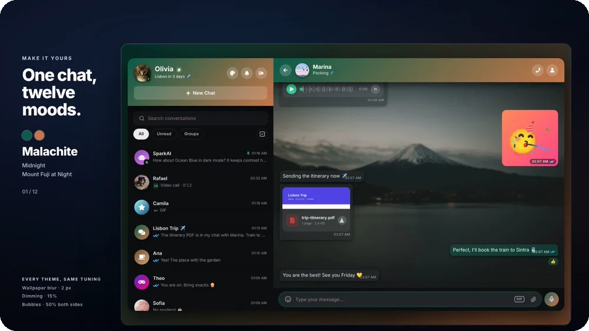
</picture>

## Only you can read it

Messages and attachments are encrypted in the browser with libsodium. The server only stores ciphertext.

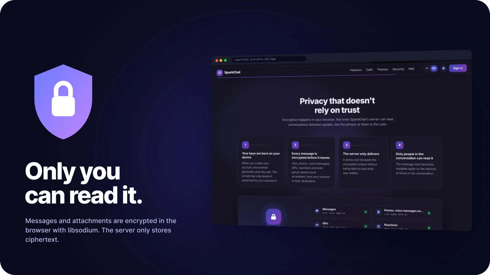

## Video calls, end to end

Voice and video calls go directly between devices over WebRTC, with screen sharing, camera switching, noise reduction, and signed signaling.

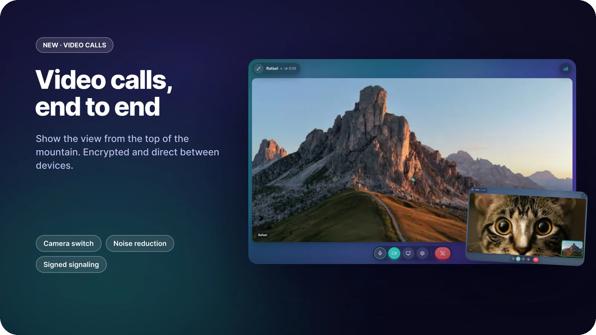

## Meet SparkAI

An assistant pinned to the top of your list. It plans trips, summarizes files, and helps you pick a color.

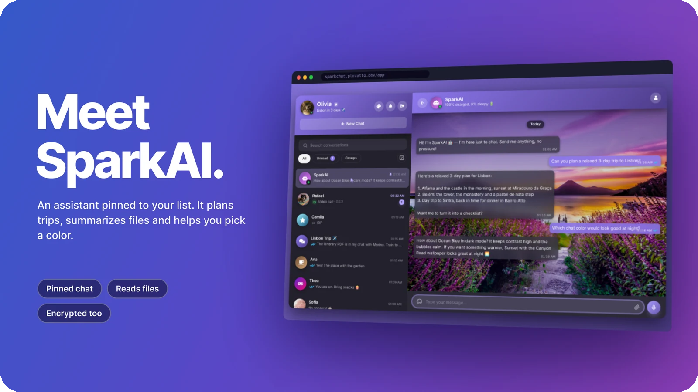

## Same chat, your style

The default look on the left, Midnight mode with the Galaxy theme, the Milky Way wallpaper, and glass bubbles on the right.

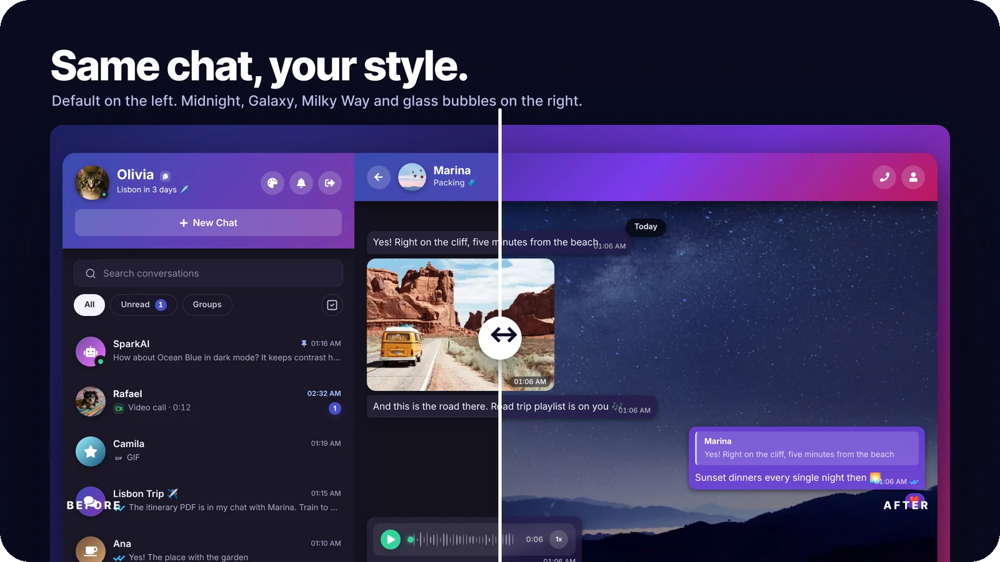

## Theme recipes

Mode, color theme, wallpaper, and bubble colors: six combinations that just work together.

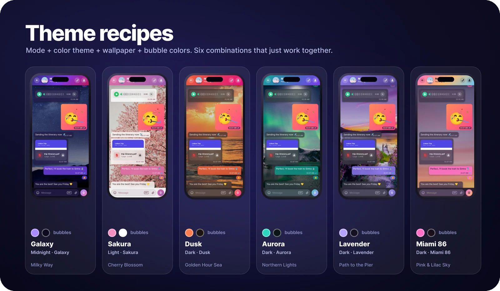

## 96 themes, 121 wallpapers

Three modes (dark, light, and midnight), applied to one chat or to all of them.

<table>
  <tr>
    <td width="50%">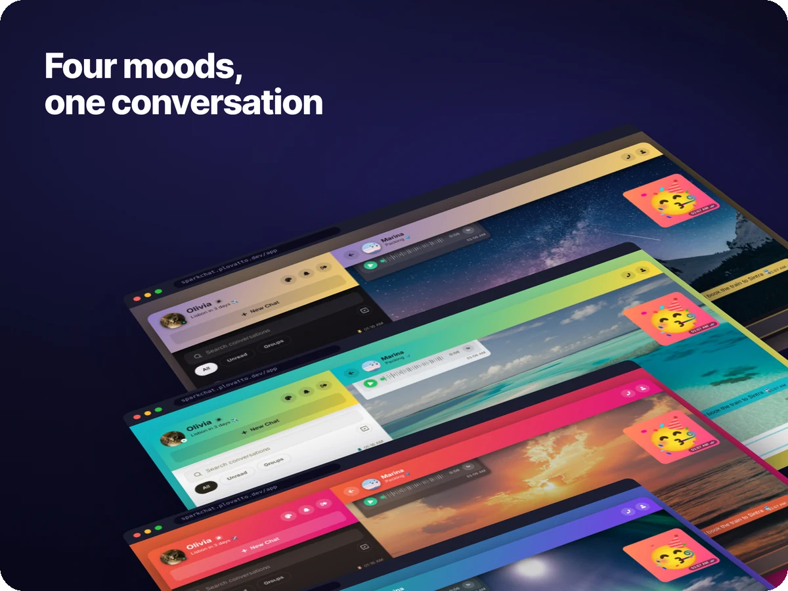</td>
    <td width="50%">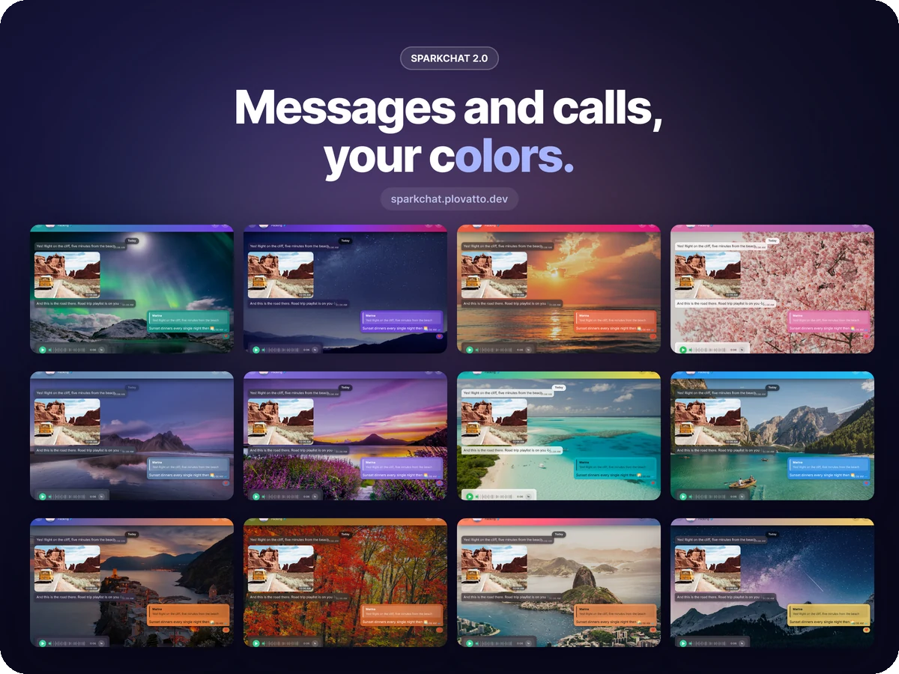</td>
  </tr>
</table>

## Open it on your phone

SparkChat runs in the browser and installs as an app.

<a href="https://sparkchat.plovatto.dev/en/">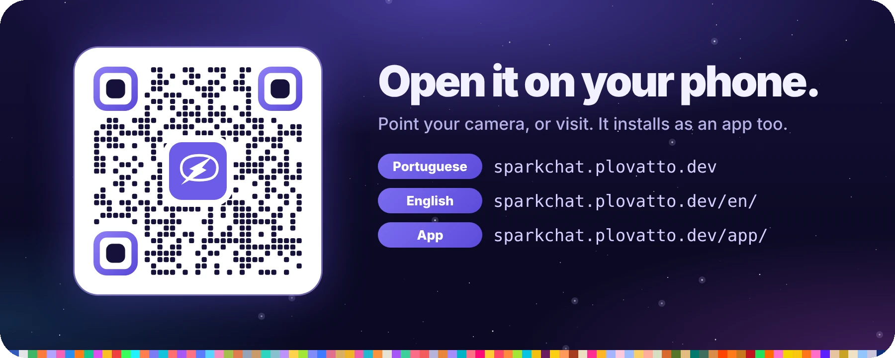</a>

## Features

Everything a modern chat needs, with privacy built in.

<table>
  <tr>
    <td width="50%" valign="top">
      <p><br><strong>End-to-end encryption</strong><br>Messages, files, reactions, and group names are encrypted in the browser before they leave the device.</p>
      <br>
      <p><br><strong>SparkAI assistant</strong><br>A pinned chat that plans, summarizes files, and answers right inside the conversation.</p>
      <br>
      <p><br><strong>Rich messages</strong><br>Photos, voice messages, files with previews, GIFs, reactions, quoted replies, and typing and recording indicators.</p>
    </td>
    <td width="50%" valign="top">
      <p><br><strong>Encrypted calls</strong><br>Voice and video over WebRTC, with screen sharing, camera switching, and noise reduction.</p>
      <br>
      <p><br><strong>Make it yours</strong><br>3 modes, 96 color themes, 121 wallpapers, and custom bubble colors, transparency, and blur, synced across devices.</p>
      <br>
      <p><br><strong>Private translation</strong><br>Messages are translated between Portuguese and English right in the browser. No message text leaves the device.</p>
    </td>
  </tr>
</table>

<details>
<summary>See every feature</summary>

<br>

<p align="center"></p>

- Real-time chat with Socket.IO, with automatic re-authentication on every reconnection
- Private chats and groups with invite links
- Thumbnails generated on the client for the conversation preview
- Browser notifications, sounds, and an unread badge
- Portuguese and English interface, with the initial language taken from the system and a switch at any time
- Installable as an app, with a presentation page rendered per language for search engines

</details>

## Tech stack

The web client in this repository, and the API it talks to.

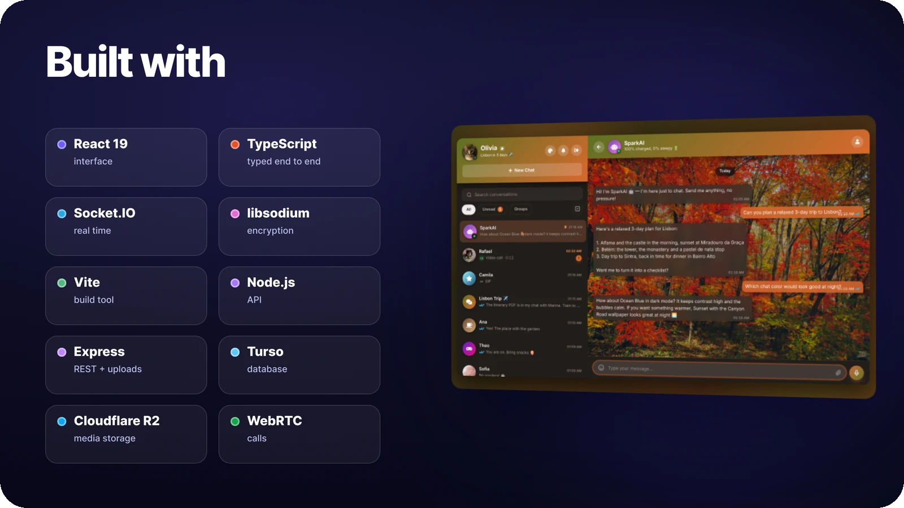

<details>
<summary>See every tool in the web client</summary>

| Technology                                                                                       | Used for                                  |
| :----------------------------------------------------------------------------------------------- | :---------------------------------------- |
| [React](https://react.dev/) 19 + [TypeScript](https://www.typescriptlang.org/)                   | Interface and typed components            |
| [Vite](https://vite.dev/)                                                                        | Development server and build              |
| [Bootstrap](https://getbootstrap.com/) 5 + [React Bootstrap](https://react-bootstrap.github.io/) | Layout and base components                |
| [Socket.IO Client](https://socket.io/docs/v4/client-api/)                                        | Real-time messaging                       |
| [libsodium](https://doc.libsodium.org/)                                                          | End-to-end encryption                     |
| WebRTC + [RNNoise](https://github.com/jitsi/rnnoise-wasm)                                        | Calls and noise reduction                 |
| [Bergamot translator](https://browser.mt/) + Mozilla models                                      | In-browser translation                    |
| [PDF.js](https://mozilla.github.io/pdf.js/)                                                      | File previews                             |
| [i18next](https://www.i18next.com/) + [react-i18next](https://react.i18next.com/)                | Internationalization                      |
| [Vitest](https://vitest.dev/), [fast-check](https://fast-check.dev/), and Testing Library        | Unit, property-based, and component tests |
| ESLint                                                                                           | Code analysis                             |

</details>

## Quality and security

Every change goes through the same steps before it goes live.

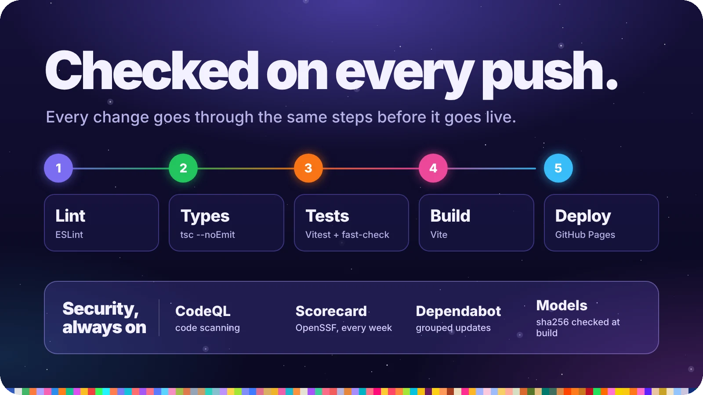

<details>
<summary>How each check works</summary>

- [`ci.yml`](.github/workflows/ci.yml) runs lint, the type check, and the tests on every push and pull request to `main`.
- [`deploy-pages.yml`](.github/workflows/deploy-pages.yml) builds and publishes the site on every push to `main`.
- [CodeQL](https://github.com/Plovatto/SparkChat/security/code-scanning) scans the code, and the [OpenSSF Scorecard](https://scorecard.dev/viewer/?uri=github.com/Plovatto/SparkChat) runs every week.
- Dependabot groups dependency updates.
- The translation models are downloaded and verified by sha256 during the build.

</details>

## Getting started

Requires [Node.js](https://nodejs.org/) 20 or newer and npm. To test the full experience, keep the [SparkChat API](https://github.com/Plovatto/API-SparkChat) running too.

1. Clone the repository and install the dependencies:

   ```bash
   git clone https://github.com/Plovatto/SparkChat.git
   cd SparkChat
   npm install
   ```

2. Copy the environment file:

   ```bash
   cp .env.example .env
   ```

3. Start the development server. The presentation page opens at <http://localhost:5173> and the app at <http://localhost:5173/app/>:

   ```bash
   npm run dev
   ```

| Variable                      | Description                                                                     |
| :---------------------------- | :------------------------------------------------------------------------------ |
| `VITE_API_URL`                | URL of the SparkChat API, for example `http://localhost:3001`                   |
| `VITE_SOCKET_URL`             | URL of the Socket.IO server, usually the same as the API                        |
| `VITE_MEDIA_ORIGIN`           | Optional. Origin that serves uploaded media, such as the public R2 bucket URL   |
| `VITE_TRANSLATION_MODELS_URL` | Optional. Another origin for the translation models, such as a bucket with CORS |
| `VITE_KT_LOG_PUBLIC_KEY`      | Optional. Pins the key transparency log's public key at build time              |
| `VITE_KT_WITNESS_URL`         | Optional. URL of the signed head published by the key transparency witness      |

> [!NOTE]
> If the API runs on another URL, update `VITE_API_URL` and `VITE_SOCKET_URL`. The frontend URL must also be listed in `FRONTEND_URL` on the API, which controls CORS.

## How it works

<details>
<summary>Media origin</summary>

When `VITE_MEDIA_ORIGIN` is set (for example, the public URL of the R2 bucket, the same as `R2_PUBLIC_BASE_URL` on the API), the app only fetches media from that origin and the Content-Security-Policy allows connections only to it. Without it, the app accepts any `https` origin, as long as the path is `/uploads/images/`, `/uploads/audio/`, or `/uploads/files/`.

</details>

<details>
<summary>Content-Security-Policy</summary>

During the build, both pages (`index.html` and `app/index.html`) receive a Content-Security-Policy in a `<meta http-equiv>` tag. It allows scripts from the site itself (plus the sha256 hash of the presentation page's startup script, computed at build time), `wasm-unsafe-eval` for libsodium and Bergamot, workers from the site and `blob:`, connections to `VITE_API_URL`, `VITE_SOCKET_URL` (http and ws), the media origin, and `VITE_TRANSLATION_MODELS_URL`, and images from the site, `blob:`, `data:`, and Unsplash (wallpapers). Plugins, frames, `<base>`, and form submissions are blocked. The development server does not apply the policy.

</details>

<details>
<summary>Key transparency</summary>

`VITE_KT_LOG_PUBLIC_KEY` and `VITE_KT_WITNESS_URL` are optional and only apply when the API turns on key transparency (`KEY_TRANSPARENCY_ENABLED`). The first pins the log's public key at build time, instead of trusting the one the server announces on first use. The second is the URL of the signed head published by the witness (for example, a file on GitHub Pages); when set, the Content-Security-Policy also allows connections to its origin.

With key transparency turned off on the server, the app does nothing extra, unless the account has used the log before or the build pins the key: in that case, the missing configuration raises a downgrade warning, and with a pinned key the app refuses new or changed contact keys until the log comes back. The rollout steps are in the API repository (`docs/key-transparency.md`).

</details>

<details>
<summary>Message translation</summary>

The app can translate messages between Portuguese and English right in the browser. It uses Mozilla's pt↔en models (MPL-2.0), downloaded and verified by sha256 during the build (`npm run models:fetch`, which runs automatically on `dev` and `build`) and served by the site itself. No message text leaves the device. Optionally, `VITE_TRANSLATION_MODELS_URL` points to another origin for the models.

</details>

<details>
<summary>Local setup with the API</summary>

```text
Presentation: http://localhost:5173
App:          http://localhost:5173/app/
API:          http://localhost:3001
```

</details>

## Scripts

| Command              | Description                                          |
| :------------------- | :--------------------------------------------------- |
| `npm run dev`        | Starts the development server                        |
| `npm run build`      | Runs the type check and creates the production build |
| `npm run preview`    | Serves the production build locally                  |
| `npm run typecheck`  | Runs the type check without emitting files           |
| `npm run lint`       | Runs ESLint                                          |
| `npm run lint:fix`   | Fixes lint problems automatically                    |
| `npm test`           | Runs the tests                                       |
| `npm run test:watch` | Runs the tests in watch mode                         |

## Project structure

<details>
<summary>View the folder tree</summary>

```text
src/
├── app/              # Main app, authentication gate, and global provider
├── assets/           # Images, icons, and static files
├── components/       # Reusable interface components (modal, spinner, buttons, and more)
├── config/           # Environment variable reading
├── constants/        # Shared constants, such as layout breakpoints
├── features/
│   ├── auth/         # Sign in, sign up, session, and socket sync
│   ├── chat/         # Conversation area, messages, attachments, effects, and uploads
│   ├── landing/      # Presentation page at the root, with a theme preview
│   ├── notifications/# Browser notifications, sounds, and unread badge
│   ├── rooms/        # Conversation list, profile, new chat, and room helpers
│   └── theme/        # Themes, wallpapers, and bubble appearance
├── hooks/            # Hooks shared between features
├── lib/              # API, socket, E2EE, language, storage, audio, media, and formatting
├── locales/          # Portuguese and English translations (landing, app, and theme names)
├── styles/           # Global styles, animations, and responsiveness
├── types/            # Global type declarations
├── main.tsx
└── vite-env.d.ts
```

</details>

## Deployment

<details>
<summary>How the site is published to GitHub Pages</summary>

The site is published to GitHub Pages by [`deploy-pages.yml`](.github/workflows/deploy-pages.yml) on every push to `main`. It is served on `sparkchat.plovatto.dev`, and the API on `sparkchat-api.plovatto.dev`.

The root (`/`) shows the presentation page in Portuguese, `/en/` shows it in English, and the app lives at `/app/`. Before the page appears, a script in the `<head>` picks the language: first the saved choice, then the system language (Portuguese or English) and, if it is neither, English. Search engines are not redirected. Visitors with a saved session who open the root go straight to the app, and old invite links (`/?join=` and `/?startChat=`) are forwarded to `/app/`.

The build has two pages: `index.html` (presentation) and `app/index.html` (app). At the end of the build, the presentation page is rendered on the server once per language and written to `dist/index.html` and `dist/en/index.html`, each with its own title, description, Open Graph, and `hreflang`.

One-time setup in the repository settings:

- **Settings → Pages:** the source must be **GitHub Actions**.
- **Settings → Pages → Custom domain:** `sparkchat.plovatto.dev`, with **Enforce HTTPS** on.
- **Settings → Environments → github-pages:** `VITE_API_URL` and `VITE_SOCKET_URL` must point to the hosted API, and `VITE_MEDIA_ORIGIN` (optional, recommended) to the public media origin. Vite embeds these variables in the build, so they must exist in the Action's environment, not only in the local `.env`.

In DNS, the `sparkchat` subdomain is a `CNAME` record pointing to `plovatto.github.io`.

</details>

## Contributing

Issues and pull requests are welcome. Read the [contributing guide](CONTRIBUTING.md) for the branch, commit, and pull request conventions.

## Security

Please do not open public issues for vulnerabilities. Report them privately as described in the [security policy](SECURITY.md).

## Changelog

Notable changes for each release are listed on the [releases page](https://github.com/Plovatto/SparkChat/releases).

## Author

**Pandora Becker Lovatto** · [@Plovatto](https://github.com/Plovatto) · [plovatto.dev](https://plovatto.dev/en/)

## License

Distributed under the [MIT License](LICENSE).

<br>

<p align="center"></p>

<p align="center"><a href="#readme"></a></p>
