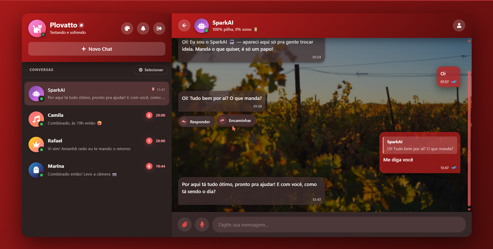
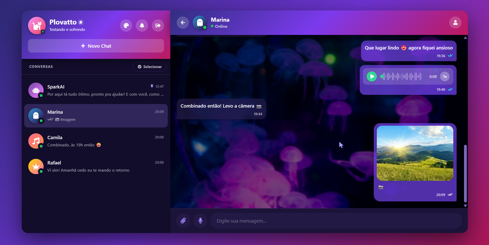
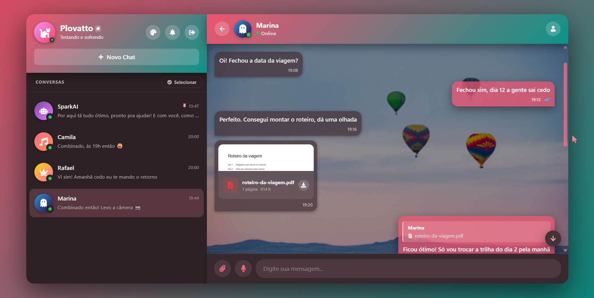

# SparkChat Web

[](https://github.com/Plovatto/SparkChat/actions/workflows/ci.yml)
[](https://github.com/Plovatto/SparkChat/security/code-scanning)
[](https://scorecard.dev/viewer/?uri=github.com/Plovatto/SparkChat)
[](https://www.bestpractices.dev/projects/16064)
[](https://github.com/Plovatto/SparkChat/actions/workflows/deploy-pages.yml)
[](LICENSE)

Interface do SparkChat, uma SPA desenvolvida com React, TypeScript e Vite para compor a experiência visual de uma aplicação de chat em tempo real.

**Acesse o app:** https://sparkchat.plovatto.dev/ · **API:** https://sparkchat-api.plovatto.dev/docs/

<p align="center">
  
</p>

<p align="center"><em>Conversa com o SparkAI, o assistente integrado</em></p>

<table>
  <tr>
    <td width="50%"></td>
    <td width="50%"></td>
  </tr>
  <tr>
    <td align="center"><em>Mensagens de áudio e imagens</em></td>
    <td align="center"><em>Anexos com pré-visualização e respostas citadas</em></td>
  </tr>
</table>


## Funcionalidades

- SPA criada com React e Vite, organizada por domínios da aplicação
- Chat em tempo real com Socket.IO, com reautenticação automática a cada reconexão
- Criptografia ponta a ponta das mensagens e dos anexos no navegador
- Envio de imagens, áudios e arquivos, com miniatura gerada no cliente para a prévia da conversa
- Temas, papéis de parede e aparência dos balões sincronizados entre dispositivos
- Notificações do navegador, sons e badge de mensagens não lidas
- Interface em português e inglês, com o idioma inicial vindo do sistema e troca a qualquer momento
- Alias de importação configurados no Vite

## Tecnologias

- [React](https://react.dev/) 19
- [TypeScript](https://www.typescriptlang.org/)
- [Vite](https://vite.dev/)
- [Bootstrap](https://getbootstrap.com/) 5
- [React Bootstrap](https://react-bootstrap.github.io/)
- [Socket.IO Client](https://socket.io/docs/v4/client-api/)
- [React Icons](https://react-icons.github.io/react-icons/)
- [i18next](https://www.i18next.com/) e [react-i18next](https://react.i18next.com/) - traduções
- ESLint - análise e padronização do código
- [Vitest](https://vitest.dev/) e [fast-check](https://fast-check.dev/) - testes unitários e baseados em propriedades

## Como Executar

### Pré-requisitos

Antes de começar, tenha instalado:

- [Node.js](https://nodejs.org/)
- npm

Para testar a integração completa, mantenha também a SparkChat API em execução.

### Instalação

Clone o repositório:

```bash
git clone https://github.com/Plovatto/SparkChat.git
```

Acesse a pasta do projeto:

```bash
cd SparkChat
```

Instale as dependências:

```bash
npm install
```

Crie o arquivo de variáveis de ambiente:

```bash
cp .env.example .env
```

Execute o servidor de desenvolvimento:

```bash
npm run dev
```

O projeto estará disponível em:

```text
http://localhost:5173
```

## Variáveis de Ambiente

As variáveis são definidas no arquivo `.env`, que não deve ser versionado.

Utilize `.env.example` como referência:

```env
VITE_API_URL=http://localhost:3001
VITE_SOCKET_URL=http://localhost:3001
VITE_MEDIA_ORIGIN=
```

`VITE_MEDIA_ORIGIN` é opcional e indica a origem que serve as mídias enviadas (por exemplo, a URL pública do bucket R2, igual a `R2_PUBLIC_BASE_URL` na API). Quando definida, o app só busca mídias dessa origem e a Content-Security-Policy libera conexões apenas para ela. Sem ela, o app continua aceitando qualquer origem `https`, desde que o caminho seja `/uploads/images/`, `/uploads/audio/` ou `/uploads/files/`.

## Content-Security-Policy

No build, as duas páginas (`index.html` e `app/index.html`) recebem uma Content-Security-Policy em `<meta http-equiv>`. Ela libera scripts do próprio site (mais o hash sha256 do script de inicialização da apresentação, calculado no build), `wasm-unsafe-eval` para libsodium e Bergamot, workers do próprio site e `blob:`, conexões para `VITE_API_URL`, `VITE_SOCKET_URL` (http e ws), a origem de mídia e `VITE_TRANSLATION_MODELS_URL`, e imagens do próprio site, `blob:`, `data:` e do Unsplash (papéis de parede). Plugins, frames, `<base>` e envio de formulários ficam bloqueados. O servidor de desenvolvimento não aplica a política.

## Tradução de mensagens

O app pode traduzir mensagens entre português e inglês direto no navegador. Os modelos são os de pt↔en do Mozilla (MPL-2.0), baixados e verificados por sha256 durante o build (`npm run models:fetch`, executado automaticamente em `dev` e `build`) e servidos pelo próprio site. Nenhum texto de mensagem sai do aparelho. Opcionalmente, `VITE_TRANSLATION_MODELS_URL` aponta para outra origem dos modelos (por exemplo, um bucket com CORS).

## Integração com a API

Este projeto foi preparado para trabalhar junto com a [SparkChat API](../API-SparkChat).

Em ambiente local, a configuração esperada é:

```text
Apresentação: http://localhost:5173
App:          http://localhost:5173/app/
API:          http://localhost:3001
```

Caso a API esteja em outra URL, atualize `VITE_API_URL` e `VITE_SOCKET_URL` no arquivo `.env`.

## Deploy

O deploy é feito no GitHub Pages pelo workflow `.github/workflows/deploy-pages.yml`, disparado a cada push na branch `main`.

O site é servido no domínio próprio `sparkchat.plovatto.dev`, e a API em `sparkchat-api.plovatto.dev`. A raiz (`/`) mostra a página de apresentação em português, `/en/` mostra a mesma página em inglês e o app fica em `/app/`. Antes de a página aparecer, um script no `<head>` escolhe o idioma: primeiro a escolha salva, depois o idioma do sistema (português ou inglês) e, se não for nenhum dos dois, inglês. Buscadores não são redirecionados. Quem já tem sessão salva no navegador e abre a raiz vai direto para o app, e links de convite antigos (`/?join=` e `/?startChat=`) são repassados para `/app/`.

Três configurações são necessárias no repositório:

- Em **Settings → Pages**, a origem deve estar como **GitHub Actions**.
- Em **Settings → Pages → Custom domain**, o valor deve ser `sparkchat.plovatto.dev`, com **Enforce HTTPS** ativo.
- Em **Settings → Environments → github-pages**, os valores `VITE_API_URL` e `VITE_SOCKET_URL` devem apontar para a API hospedada, e `VITE_MEDIA_ORIGIN` (opcional, recomendado) para a origem pública das mídias. O Vite embute essas variáveis no build, então elas precisam existir no ambiente da Action, não apenas no `.env` local.

No DNS do domínio, o subdomínio `sparkchat` é um registro `CNAME` apontando para `plovatto.github.io`.

O build tem duas páginas: `index.html` (apresentação) e `app/index.html` (app). O `base` do Vite permanece no padrão (`/`). Ao final do build, a página de apresentação é renderizada no servidor uma vez por idioma e gravada em `dist/index.html` e `dist/en/index.html`, cada uma com título, descrição, Open Graph e `hreflang` no próprio idioma, para que o conteúdo já chegue pronto aos buscadores. No servidor de desenvolvimento, o app fica em `http://localhost:5173/app/`.

A URL do frontend também precisa constar em `FRONTEND_URL` na API, que controla o CORS.

## Scripts

| Comando              | Descrição                                              |
| -------------------- | ------------------------------------------------------ |
| `npm run dev`        | Inicia o servidor de desenvolvimento                   |
| `npm run build`      | Executa a checagem de tipos e gera o build de produção |
| `npm run preview`    | Executa localmente o build de produção                 |
| `npm run typecheck`  | Executa a checagem de tipos sem gerar arquivos         |
| `npm run lint`       | Executa a análise do código com ESLint                 |
| `npm run lint:fix`   | Corrige problemas de lint automaticamente              |
| `npm test`           | Executa os testes                                      |
| `npm run test:watch` | Executa os testes em modo de observação                |

## Estrutura do Projeto

```text
src/
├── app/              # App principal, gate de autenticação e provider global
├── assets/           # Imagens, ícones e arquivos estáticos da aplicação
├── components/       # Componentes reutilizáveis de interface (modal, spinner, botões, etc.)
├── config/           # Leitura das variáveis de ambiente
├── constants/        # Constantes compartilhadas (ex.: breakpoints de layout)
├── features/
│   ├── auth/         # Login, cadastro, sessão e sincronização com o socket
│   ├── chat/         # Área de conversa, mensagens, anexos, efeitos e uploads
│   ├── landing/      # Página de apresentação da raiz, com prévia dos temas
│   ├── notifications/# Notificações do navegador, sons e badge de não lidas
│   ├── rooms/        # Lista de conversas, perfil, novo chat e helpers de sala
│   └── theme/        # Temas, papéis de parede e aparência dos balões
├── hooks/            # Hooks reutilizáveis entre features
├── lib/              # Clientes de API, socket, E2EE, idioma, storage, áudio, mídia e formatação
├── locales/          # Traduções em português e inglês (landing, app e nomes de temas)
├── styles/           # Estilos globais, animações e responsividade
├── types/            # Declarações de tipos globais
├── main.tsx
└── vite-env.d.ts
```
