<div align="center">
  <a href="https://sparkchat.plovatto.dev/">
    <picture>
      <source media="(prefers-reduced-motion: reduce)" srcset="./.github/assets/hero-still-pt.webp">
      
    </picture>
  </a>

  <br>
  <br>

<a href="https://sparkchat.plovatto.dev/"></a>
&nbsp;
<a href="https://sparkchat-api.plovatto.dev/docs/"></a>
&nbsp;
<a href="README.md"></a>

  <br>
  <br>

<a href="https://github.com/Plovatto/SparkChat/actions/workflows/ci.yml"></a>
<a href="https://scorecard.dev/viewer/?uri=github.com/Plovatto/SparkChat"></a>
<a href="https://www.bestpractices.dev/projects/16064"></a>
<a href="LICENSE"></a>
</div>

<br>

<p align="center">O SparkChat é um chat em tempo real em que mensagens, arquivos e chamadas são criptografados no navegador, então nem o servidor consegue ler. Este repositório é o cliente web: a página de apresentação e o app. O servidor fica em <a href="https://github.com/Plovatto/API-SparkChat">API-SparkChat</a>.</p>

<p align="center"></p>

<details>
<summary><strong>Sumário</strong></summary>

- [Um chat, doze climas](#um-chat-doze-climas)
- [Só você consegue ler](#só-você-consegue-ler)
- [Chamadas de vídeo, de ponta a ponta](#chamadas-de-vídeo-de-ponta-a-ponta)
- [Conheça a SparkAI](#conheça-a-sparkai)
- [O mesmo chat, do seu jeito](#o-mesmo-chat-do-seu-jeito)
- [Receitas de tema](#receitas-de-tema)
- [96 temas, 121 papéis de parede](#96-temas-121-papéis-de-parede)
- [Abra no celular](#abra-no-celular)
- [Funcionalidades](#funcionalidades)
- [Tecnologias](#tecnologias)
- [Qualidade e segurança](#qualidade-e-segurança)
- [Como executar](#como-executar)
- [Como funciona](#como-funciona)
- [Scripts](#scripts)
- [Estrutura do projeto](#estrutura-do-projeto)
- [Deploy](#deploy)
- [Como contribuir](#como-contribuir)
- [Segurança](#segurança)
- [Changelog](#changelog)
- [Autora](#autora)
- [Licença](#licença)

</details>

## Um chat, doze climas

Cada tema muda o app inteiro de uma vez: cores, papel de parede e balões, ajustados para continuar legíveis em cada combinação.

<picture>
  <source media="(prefers-reduced-motion: reduce)" srcset="./.github/assets/themes-still.webp">
  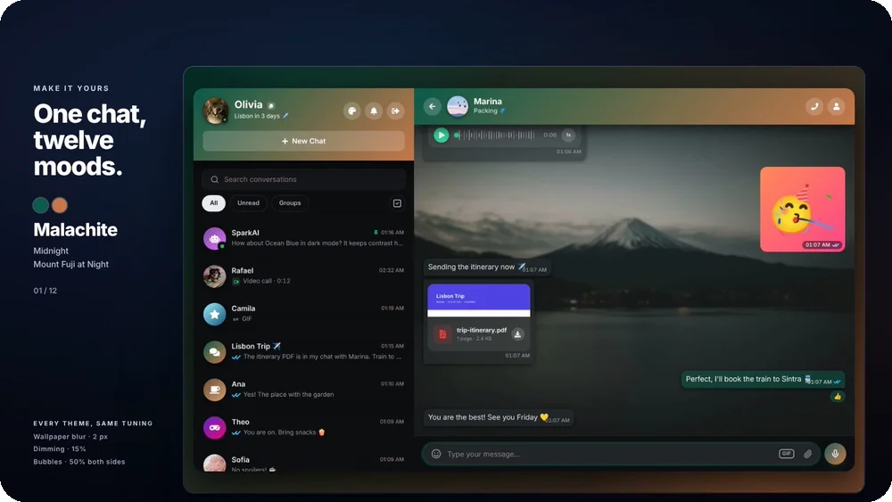
</picture>

## Só você consegue ler

Mensagens e anexos são criptografados no navegador com libsodium. O servidor só guarda texto cifrado.

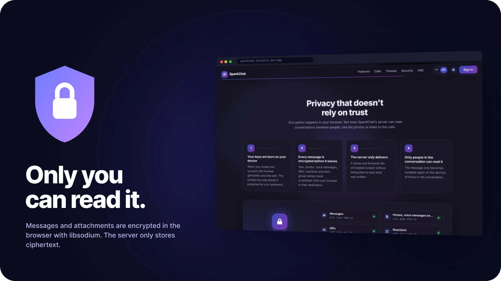

## Chamadas de vídeo, de ponta a ponta

Chamadas de voz e vídeo vão direto entre os aparelhos por WebRTC, com compartilhamento de tela, troca de câmera, redução de ruído e sinalização assinada.

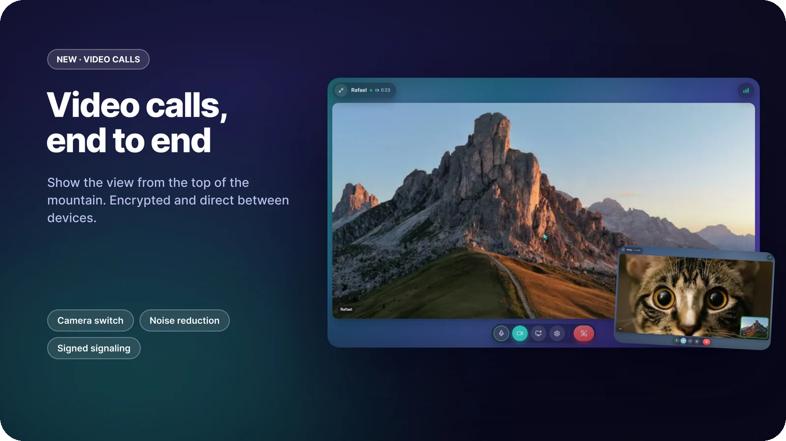

## Conheça a SparkAI

Uma assistente fixada no topo da sua lista. Ela planeja viagens, resume arquivos e ajuda a escolher uma cor.

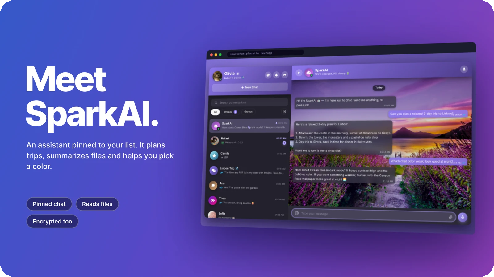

## O mesmo chat, do seu jeito

À esquerda, o visual padrão. À direita, o modo Meia-Noite com o tema Galáxia, o papel de parede Via Láctea e balões de vidro.

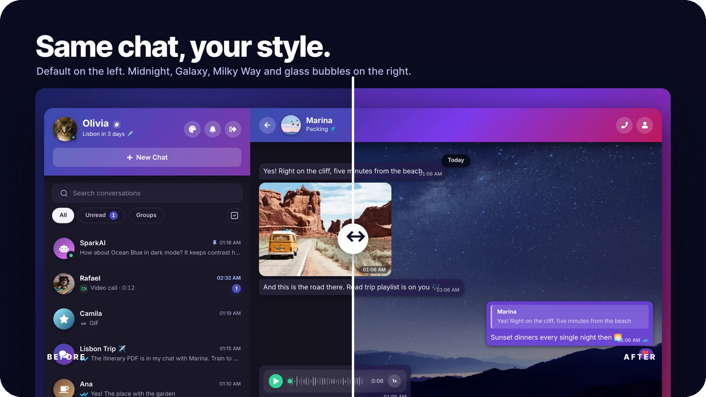

## Receitas de tema

Modo, tema de cor, papel de parede e cores dos balões: seis combinações que funcionam juntas.

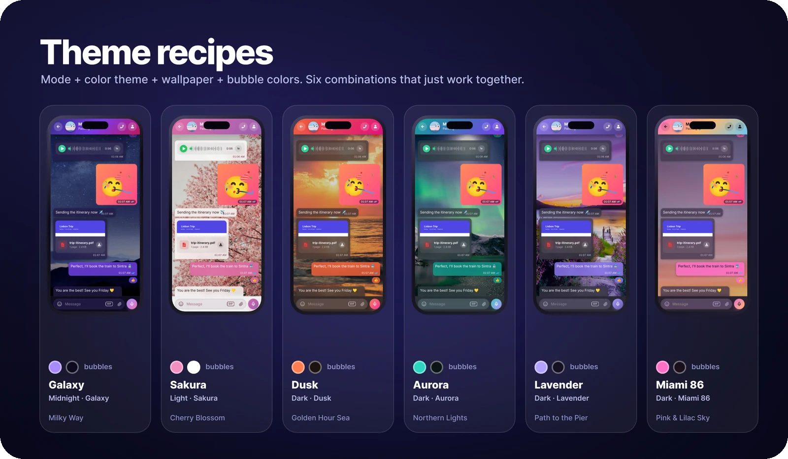

## 96 temas, 121 papéis de parede

Três modos (escuro, claro e meia-noite), aplicados a um chat ou a todos.

<table>
  <tr>
    <td width="50%">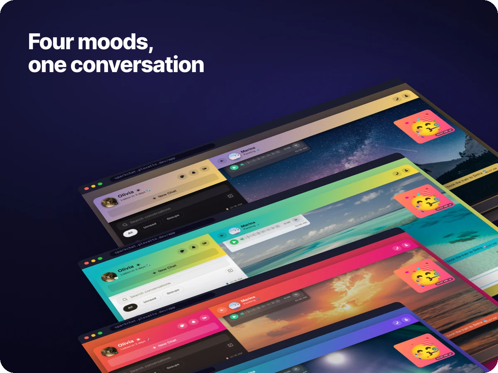</td>
    <td width="50%">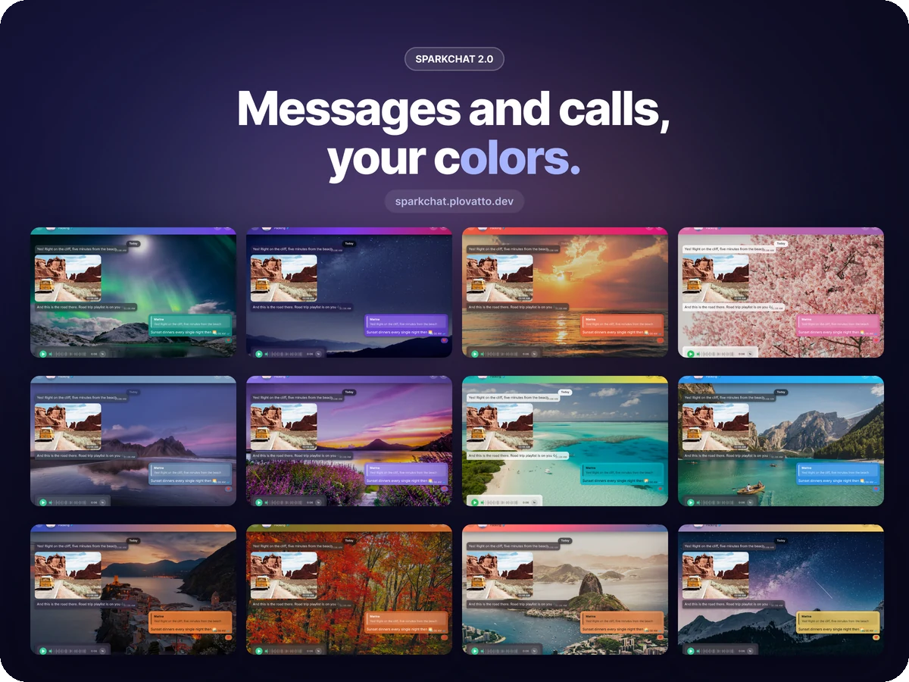</td>
  </tr>
</table>

## Abra no celular

O SparkChat roda no navegador e pode ser instalado como app.

<a href="https://sparkchat.plovatto.dev/">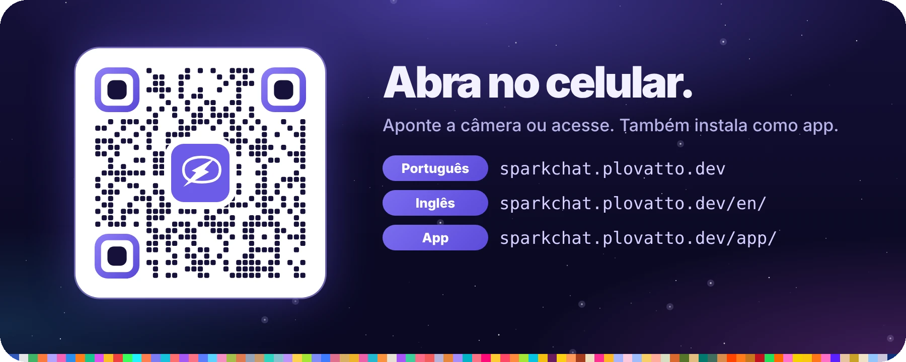</a>

## Funcionalidades

Tudo o que um chat moderno precisa, com privacidade de fábrica.

<table>
  <tr>
    <td width="50%" valign="top">
      <p><br><strong>Criptografia de ponta a ponta</strong><br>Mensagens, arquivos, reações e nomes de grupo são criptografados no navegador antes de sair do aparelho.</p>
      <br>
      <p><br><strong>Assistente SparkAI</strong><br>Um chat fixado que planeja, resume arquivos e responde dentro da própria conversa.</p>
      <br>
      <p><br><strong>Mensagens completas</strong><br>Fotos, mensagens de voz, arquivos com prévia, GIFs, reações, respostas citadas e indicadores de digitação e gravação.</p>
    </td>
    <td width="50%" valign="top">
      <p><br><strong>Chamadas criptografadas</strong><br>Voz e vídeo por WebRTC, com compartilhamento de tela, troca de câmera e redução de ruído.</p>
      <br>
      <p><br><strong>Do seu jeito</strong><br>3 modos, 96 temas de cor, 121 papéis de parede e balões com cor, transparência e desfoque, sincronizados entre aparelhos.</p>
      <br>
      <p><br><strong>Tradução privada</strong><br>Mensagens traduzidas entre português e inglês no próprio navegador. Nenhum texto sai do aparelho.</p>
    </td>
  </tr>
</table>

<details>
<summary>Ver todas as funcionalidades</summary>

<br>

<p align="center"></p>

- Chat em tempo real com Socket.IO, com nova autenticação automática a cada reconexão
- Chats privados e grupos com links de convite
- Miniaturas geradas no cliente para a prévia da conversa
- Notificações do navegador, sons e contador de não lidas
- Interface em português e inglês, com o idioma inicial vindo do sistema e troca a qualquer momento
- Instalável como app, com página de apresentação renderizada por idioma para os buscadores

</details>

## Tecnologias

O cliente web deste repositório e a API com que ele conversa.

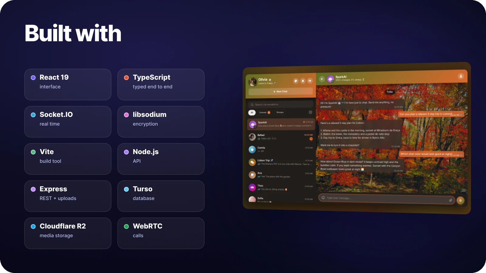

<details>
<summary>Ver todas as ferramentas do cliente web</summary>

| Tecnologia                                                                                       | Uso                                                 |
| :----------------------------------------------------------------------------------------------- | :-------------------------------------------------- |
| [React](https://react.dev/) 19 + [TypeScript](https://www.typescriptlang.org/)                   | Interface e componentes tipados                     |
| [Vite](https://vite.dev/)                                                                        | Servidor de desenvolvimento e build                 |
| [Bootstrap](https://getbootstrap.com/) 5 + [React Bootstrap](https://react-bootstrap.github.io/) | Layout e componentes base                           |
| [Socket.IO Client](https://socket.io/docs/v4/client-api/)                                        | Mensagens em tempo real                             |
| [libsodium](https://doc.libsodium.org/)                                                          | Criptografia de ponta a ponta                       |
| WebRTC + [RNNoise](https://github.com/jitsi/rnnoise-wasm)                                        | Chamadas e redução de ruído                         |
| [Bergamot translator](https://browser.mt/) + modelos do Mozilla                                  | Tradução no navegador                               |
| [PDF.js](https://mozilla.github.io/pdf.js/)                                                      | Prévia de arquivos                                  |
| [i18next](https://www.i18next.com/) + [react-i18next](https://react.i18next.com/)                | Internacionalização                                 |
| [Vitest](https://vitest.dev/), [fast-check](https://fast-check.dev/) e Testing Library           | Testes unitários, por propriedades e de componentes |
| ESLint                                                                                           | Análise do código                                   |

</details>

## Qualidade e segurança

Toda mudança passa pelas mesmas etapas antes de ir para o ar.

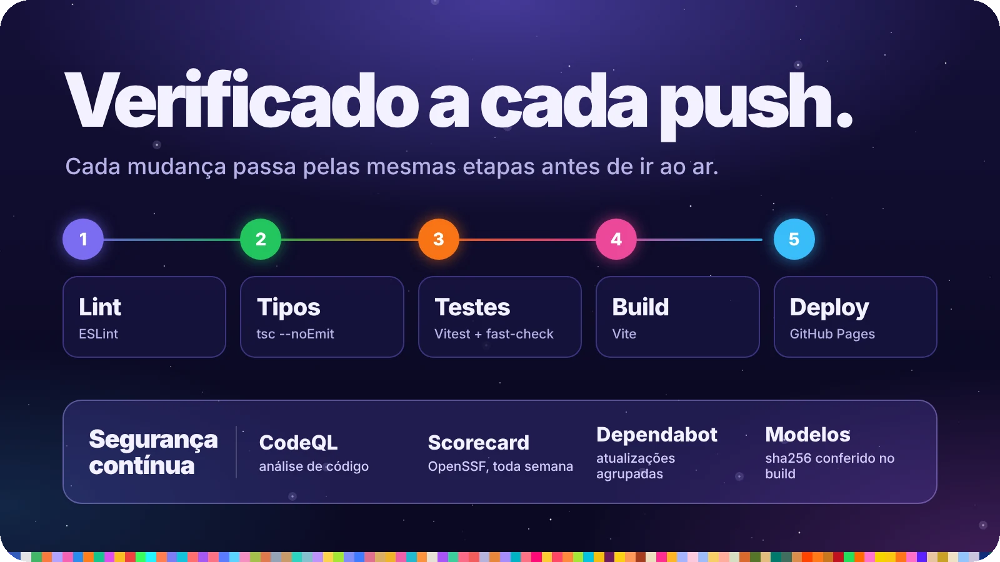

<details>
<summary>Como cada verificação funciona</summary>

- [`ci.yml`](.github/workflows/ci.yml) roda o lint, a checagem de tipos e os testes a cada push e pull request na `main`.
- [`deploy-pages.yml`](.github/workflows/deploy-pages.yml) gera o build e publica o site a cada push na `main`.
- O [CodeQL](https://github.com/Plovatto/SparkChat/security/code-scanning) analisa o código, e o [OpenSSF Scorecard](https://scorecard.dev/viewer/?uri=github.com/Plovatto/SparkChat) roda toda semana.
- [`lighthouse.yml`](.github/workflows/lighthouse.yml) audita as páginas de apresentação em português e inglês em acessibilidade, boas práticas e SEO.
- [`pr-title.yml`](.github/workflows/pr-title.yml) confere se o título do pull request segue o formato gitmoji com Conventional Commits.
- O Dependabot agrupa as atualizações de dependências.
- Os modelos de tradução são baixados e conferidos por sha256 durante o build.

</details>

## Como executar

Requer [Node.js](https://nodejs.org/) 20 ou mais recente (o CI usa a versão do [`.nvmrc`](.nvmrc)) e npm. Para testar a experiência completa, mantenha a [SparkChat API](https://github.com/Plovatto/API-SparkChat) rodando também.

1. Clone o repositório e instale as dependências:

   ```bash
   git clone https://github.com/Plovatto/SparkChat.git
   cd SparkChat
   npm install
   ```

2. Copie o arquivo de ambiente:

   ```bash
   cp .env.example .env
   ```

3. Inicie o servidor de desenvolvimento. A página de apresentação abre em <http://localhost:5173> e o app em <http://localhost:5173/app/>:

   ```bash
   npm run dev
   ```

| Variável                      | Descrição                                                                             |
| :---------------------------- | :------------------------------------------------------------------------------------ |
| `VITE_API_URL`                | URL da SparkChat API, por exemplo `http://localhost:3001`                             |
| `VITE_SOCKET_URL`             | URL do servidor Socket.IO, normalmente a mesma da API                                 |
| `VITE_MEDIA_ORIGIN`           | Opcional. Origem que serve as mídias enviadas, como a URL pública do bucket R2        |
| `VITE_TRANSLATION_MODELS_URL` | Opcional. Outra origem para os modelos de tradução, como um bucket com CORS           |
| `VITE_KT_LOG_PUBLIC_KEY`      | Opcional. Fixa no build a chave pública do registro de transparência de chaves        |
| `VITE_KT_WITNESS_URL`         | Opcional. URL da cabeça assinada publicada pela testemunha da transparência de chaves |

> [!NOTE]
> Se a API estiver em outra URL, atualize `VITE_API_URL` e `VITE_SOCKET_URL`. A URL do frontend também precisa constar em `FRONTEND_URL` na API, que controla o CORS.

## Como funciona

<details>
<summary>Origem das mídias</summary>

Quando `VITE_MEDIA_ORIGIN` está definida (por exemplo, a URL pública do bucket R2, igual a `R2_PUBLIC_BASE_URL` na API), o app só busca mídias dessa origem e a Content-Security-Policy libera conexões apenas para ela. Sem ela, o app aceita qualquer origem `https`, desde que o caminho seja `/uploads/images/`, `/uploads/audio/` ou `/uploads/files/`.

</details>

<details>
<summary>Content-Security-Policy</summary>

No build, as duas páginas (`index.html` e `app/index.html`) recebem uma Content-Security-Policy em `<meta http-equiv>`. Ela libera scripts do próprio site (mais o hash sha256 do script de inicialização da apresentação, calculado no build), `wasm-unsafe-eval` para libsodium e Bergamot, workers do próprio site e `blob:`, conexões para `VITE_API_URL`, `VITE_SOCKET_URL` (http e ws), a origem de mídia e `VITE_TRANSLATION_MODELS_URL`, e imagens do próprio site, `blob:`, `data:` e do Unsplash (papéis de parede). Plugins, frames, `<base>` e envio de formulários ficam bloqueados. O servidor de desenvolvimento não aplica a política.

</details>

<details>
<summary>Transparência de chaves</summary>

`VITE_KT_LOG_PUBLIC_KEY` e `VITE_KT_WITNESS_URL` são opcionais e só valem quando a API liga a transparência de chaves (`KEY_TRANSPARENCY_ENABLED`). A primeira fixa no build a chave pública do registro, em vez de confiar na que o servidor anuncia no primeiro uso. A segunda é a URL da cabeça assinada publicada pela testemunha (por exemplo, um arquivo no GitHub Pages); quando definida, a Content-Security-Policy libera conexões também para a origem dela.

Com a transparência desligada no servidor, o app não faz nada a mais, exceto quando a conta já usou o registro antes ou o build fixa a chave: nesse caso, a ausência da configuração gera um alerta de rebaixamento, e com a chave fixada o app recusa chaves novas ou alteradas de contatos até o registro voltar. O roteiro de ativação está no repositório da API (`docs/key-transparency.md`).

</details>

<details>
<summary>Tradução de mensagens</summary>

O app pode traduzir mensagens entre português e inglês direto no navegador. Os modelos são os de pt↔en do Mozilla (MPL-2.0), baixados e verificados por sha256 durante o build (`npm run models:fetch`, executado automaticamente em `dev` e `build`) e servidos pelo próprio site. Nenhum texto de mensagem sai do aparelho. Opcionalmente, `VITE_TRANSLATION_MODELS_URL` aponta para outra origem dos modelos.

</details>

<details>
<summary>Ambiente local com a API</summary>

```text
Apresentação: http://localhost:5173
App:          http://localhost:5173/app/
API:          http://localhost:3001
```

</details>

## Scripts

| Comando              | Descrição                                              |
| :------------------- | :----------------------------------------------------- |
| `npm run dev`        | Inicia o servidor de desenvolvimento                   |
| `npm run build`      | Executa a checagem de tipos e gera o build de produção |
| `npm run preview`    | Executa localmente o build de produção                 |
| `npm run typecheck`  | Executa a checagem de tipos sem gerar arquivos         |
| `npm run lint`       | Executa a análise do código com ESLint                 |
| `npm run lint:fix`   | Corrige problemas de lint automaticamente              |
| `npm test`           | Executa os testes                                      |
| `npm run test:watch` | Executa os testes em modo de observação                |

## Estrutura do projeto

<details>
<summary>Ver a árvore de pastas</summary>

```text
src/
├── app/              # App principal, gate de autenticação e provider global
├── assets/           # Imagens, ícones e arquivos estáticos da aplicação
├── components/       # Componentes reutilizáveis de interface (modal, spinner, botões e outros)
├── config/           # Leitura das variáveis de ambiente
├── constants/        # Constantes compartilhadas, como breakpoints de layout
├── features/
│   ├── auth/         # Login, cadastro, sessão e sincronização com o socket
│   ├── chat/         # Área de conversa, mensagens, anexos, efeitos e uploads
│   ├── landing/      # Página de apresentação da raiz, com prévia dos temas
│   ├── notifications/# Notificações do navegador, sons e badge de não lidas
│   ├── rooms/        # Lista de conversas, perfil, novo chat e helpers de sala
│   └── theme/        # Temas, papéis de parede e aparência dos balões
├── hooks/            # Hooks reutilizáveis entre features
├── lib/              # Clientes de API, socket, E2EE, idioma, storage, áudio, mídia e formatação
├── locales/          # Traduções em português e inglês (landing, app e nomes de temas)
├── styles/           # Estilos globais, animações e responsividade
├── types/            # Declarações de tipos globais
├── main.tsx
└── vite-env.d.ts
```

</details>

## Deploy

<details>
<summary>Como o site é publicado no GitHub Pages</summary>

O site é publicado no GitHub Pages pelo [`deploy-pages.yml`](.github/workflows/deploy-pages.yml) a cada push na `main`. Ele é servido em `sparkchat.plovatto.dev`, e a API em `sparkchat-api.plovatto.dev`.

A raiz (`/`) mostra a página de apresentação em português, `/en/` mostra a mesma página em inglês e o app fica em `/app/`. Antes de a página aparecer, um script no `<head>` escolhe o idioma: primeiro a escolha salva, depois o idioma do sistema (português ou inglês) e, se não for nenhum dos dois, inglês. Buscadores não são redirecionados. Quem já tem sessão salva e abre a raiz vai direto para o app, e links de convite antigos (`/?join=` e `/?startChat=`) são repassados para `/app/`.

O build tem duas páginas: `index.html` (apresentação) e `app/index.html` (app). Ao final do build, a página de apresentação é renderizada no servidor uma vez por idioma e gravada em `dist/index.html` e `dist/en/index.html`, cada uma com título, descrição, Open Graph e `hreflang` no próprio idioma.

Configuração única nas opções do repositório:

- **Settings → Pages:** a origem deve estar como **GitHub Actions**.
- **Settings → Pages → Custom domain:** `sparkchat.plovatto.dev`, com **Enforce HTTPS** ativo.
- **Settings → Environments → github-pages:** `VITE_API_URL` e `VITE_SOCKET_URL` devem apontar para a API hospedada, e `VITE_MEDIA_ORIGIN` (opcional, recomendado) para a origem pública das mídias. O Vite embute essas variáveis no build, então elas precisam existir no ambiente da Action, não apenas no `.env` local.

No DNS, o subdomínio `sparkchat` é um registro `CNAME` apontando para `plovatto.github.io`.

</details>

## Como contribuir

Issues e pull requests são bem-vindos. Leia o [guia de contribuição](CONTRIBUTING.md) para conhecer as convenções de branch, commit e pull request, e siga o [código de conduta](CODE_OF_CONDUCT.md).

## Segurança

Não abra issues públicas para vulnerabilidades. Relate de forma privada, como descrito na [política de segurança](SECURITY.md).

## Changelog

As mudanças relevantes ficam no [changelog](CHANGELOG.md), e cada versão é publicada na [página de releases](https://github.com/Plovatto/SparkChat/releases).

## Autora

**Pandora Becker Lovatto** · [@Plovatto](https://github.com/Plovatto) · [plovatto.dev](https://plovatto.dev/)

## Licença

Distribuído sob a [Licença MIT](LICENSE).

<br>

<p align="center"></p>

<p align="center"><a href="#readme"></a></p>
